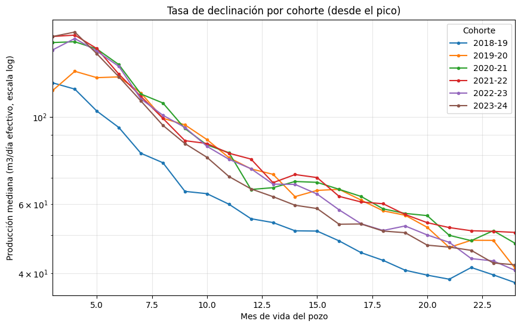
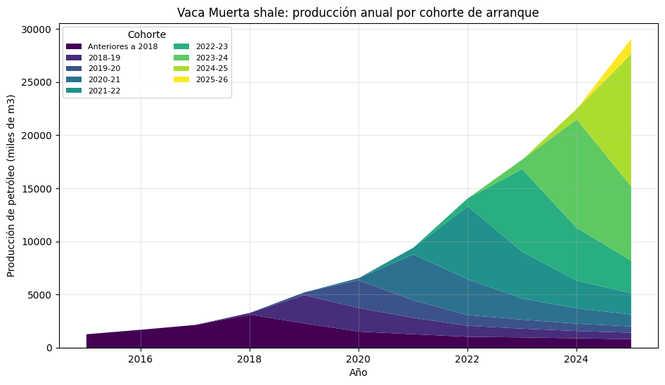

# Vaca Muerta decline curves by well cohort

Exploratory analysis of public production data from the Vaca Muerta shale formation (Argentina). It compares oil wells by the year they started producing and asks one question: do newer generations of wells decline more slowly?



*Median oil production per effective day, from the peak month, log scale. On a log scale the slope is the decline rate: parallel curves mean the cohorts decline at the same rate.*

## Main finding

Wells from the 2018-19 cohort to the 2023-24 cohort start 35% higher (median peak from 122.0 to 164.3 m3 of oil per effective day), but they do not decline more slowly. Every cohort loses close to 70% of its peak by month 24. The improvement is in initial productivity, not in decline rate.

## What was measured

- 1,090 oil wells in Vaca Muerta shale, grouped into six cohorts by year of first production (September to August window, so all six cohorts reach 24 months with the data cut at July 2026).
- 24 months followed from each well's start, with production normalized per effective day, so a month with the well shut in is not read as reservoir decline.
- The median is reported, not the mean. The mean sits about 20% above it, so the average describes a well that almost does not exist.
- Oil wells were separated from gas wells by gas-oil ratio. This reproduces the public map of production windows without using any geographic variable: nine areas come out 100% oil, and four gas areas give zero oil wells.
- The analysis starts from 216,077 monthly records and 3,377 shale wells, and uses 26,112 records from 1,090 wells (12.1%). Every exclusion is documented in the notebook.

## A trap in the data: the two newest cohorts look worse, but it is not decline

The 2022-23 and 2023-24 cohorts lose 73.2% and 73.6% from peak, against 64.7% to 68.4% for the four earlier ones. That step is not interpretable. They are the only two cohorts whose final stretch falls in 2024 and 2025, and in those years production fell across all wells.

A control group of 111 wells outside the six cohorts (started between 2016 and August 2018, open more than 80% of months) was flat before (-4.5% in 2022, 0.0% in 2023) and then lost 15.0% in 2024 and 9.6% in 2025, about 23% cumulative on a stable base. That is a period effect, not aging.



## What this analysis cannot answer

- A higher peak is what a longer horizontal section with more fracture stages would also produce. This dataset cannot separate better technique from better well design. That needs completion and fracture detail per well.
- The economic limit is out of scope. It needs operating costs and sale price, which are not in the public data.

## Data

Source: "Producción de pozos de gas y petróleo no convencional" (Chapter IV), Secretaría de Energía de la Nación, [datos.energia.gob.ar](http://datos.energia.gob.ar). The notebook downloads the CSV directly from the official source, so no data is stored in this repository.

The dataset is updated monthly. Someone running the notebook on another date may see a different row count. The results here were computed on the version downloaded on 16/09/2026 (421,046 rows).

## Run it

```
pip install pandas numpy matplotlib jupyter
jupyter notebook vaca_muerta_decline_curves.ipynb
```

It also runs in Google Colab without installing anything.

## Notes

- The notebook and chart labels are in Spanish because the source dataset and its column names are in Spanish. The stored outputs are the ones from the 16/09/2026 run.
- This is a learning and portfolio project built with public data. It is not investment or reservoir engineering advice.

## Files

- `vaca_muerta_decline_curves.ipynb`: full analysis, reproducible end to end.
- `images/`: the charts from the notebook.
